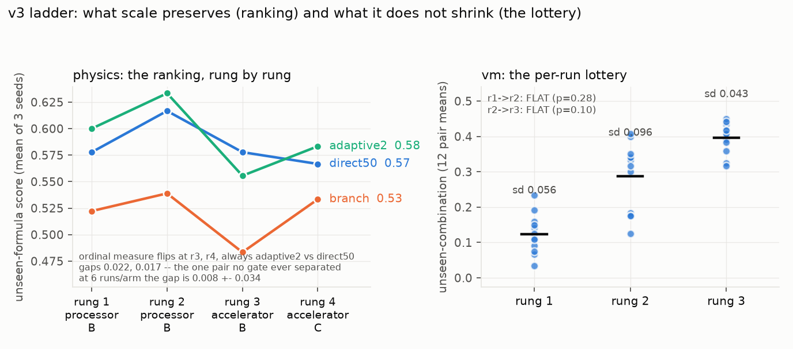
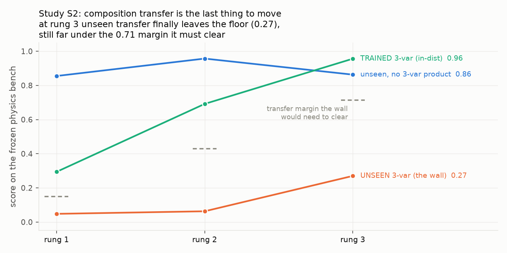
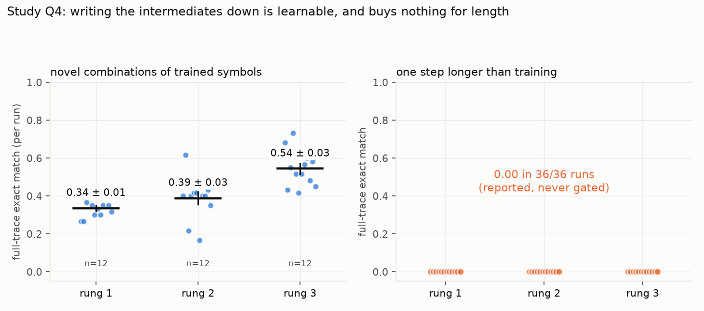
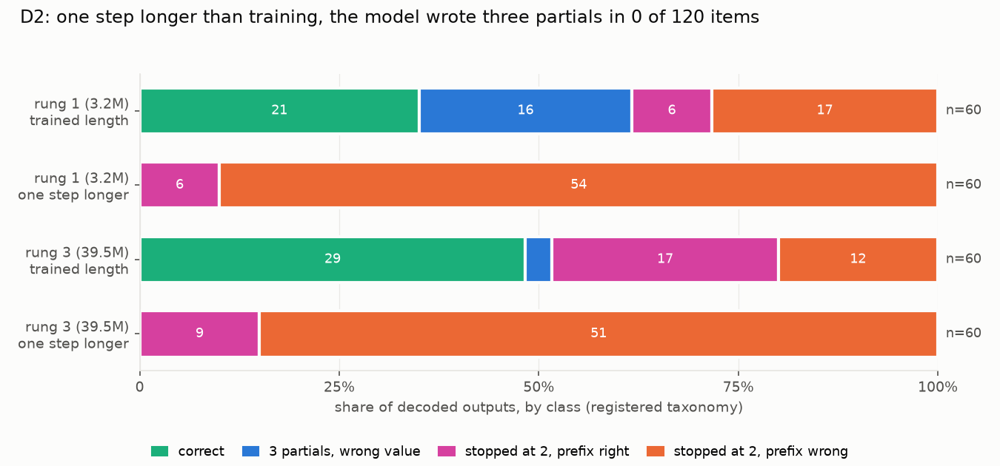
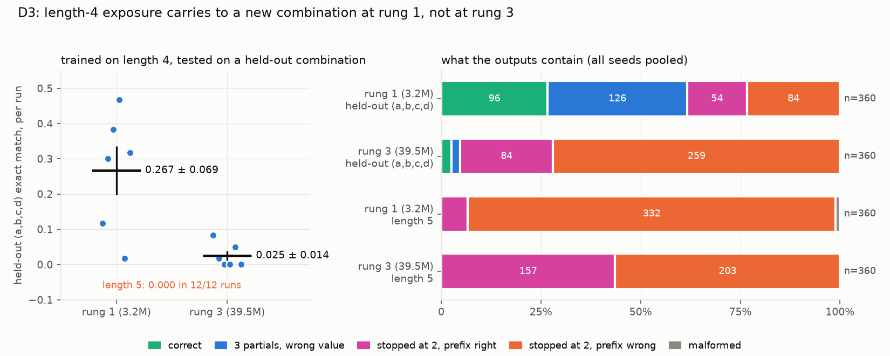
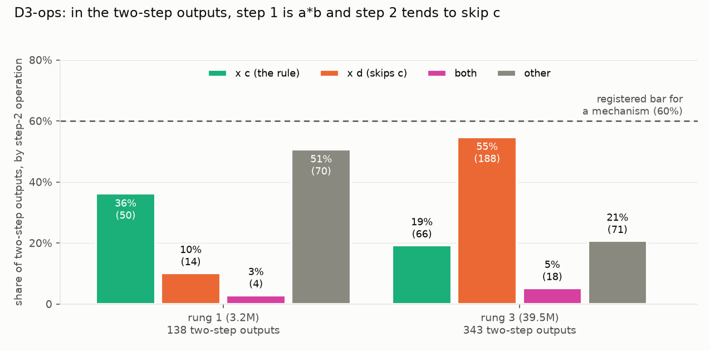

# A Core-then-Branch Curriculum's Retention Cost Survives 47x Scale While the Ordinal Ranking Never Settles: A Pre-registered Ladder from 3.2M to 151.4M Parameters

Josiah McJunkin

## Abstract

Small language models were trained at four scales, 3.2M, 10.7M, 39.5M, and 151.4M parameters on 30M to 450M tokens, and I asked whether the order of training data changes what the models can do, and whether the differences survive an order of magnitude of scale. Post-data modifications are dated and disclosed. I pre-registered the study before any code ran and froze every threshold from same-seed calibration pairs before the arm it judges ever ran. Four questions were measured. First, on the retention measure, the curriculum ranking that separates a core-then-branch curriculum from the field survived all four rungs. Core-then-branch keeps 0.02 of the basics at rung 4 against the baseline's 0.85, and its retention deficit of -0.55 to -0.83 does not soften with 47x more parameters. Branch's niche-score shortcoming, nonetheless, lost significance at rung 4, while discordant items fell from 25 to 16, so the reading is ambiguous. The ordinal rank statistic flipped twice, both times on the same pair that no gate ever separated, whose six-run-per-arm gap was 0.008 against an uncertainty of 0.034. Second, compositional transfer on unseen three-variable products sat at the floor for two rungs and then moved at rung 3. The three-seed estimate of 0.270 shrank to 0.198 +- 0.035 at twelve runs, still far under the margin it would need to clear. Third, the per-run variance of structural generalization did not narrow. I measured FLAT at both steps, now with twelve pairs per rung rather than six, an exact Brown-Forsythe permutation test, and p-values of 0.283 and 0.097. Fourth, a scratchpad format that externalizes intermediate results is learnable and improves with scale unevenly. Length extrapolation is a hard zero, 0.000 in 36 of 36 runs across the three scales. The failure was decoded by follow-up studies, revealing that the model never attempts the extra step. Training on longer chains helps the small model (0.267 +- 0.069 at 3.2M parameters, a noisy mean with six runs ranging from 0.02 to 0.47), and it does not help the large one (0.025 +- 0.014 at 39.5M). The large model's prevailing two-step pattern, first pair, then the last operand, skipping the third variable, is a 55% plurality, not a mechanism by the pre-registered 60% threshold.

## Introduction

I inherited a question from two predecessors, v1 and v2, the first of which is public while the second is not yet. That question is whether the order in which a small model sees its training data changes what it can do. V3 exists to answer whether that finding survives an order of magnitude.

Scale is the natural challenge to any finding measured at a single model size. I ran the same test across a 47x parameter range (3.2M to 151.4M) and a 15x token range (30M to 450M) to test the finding's durability. A curriculum effect observed at 3.2M parameters might reflect a quirk of that capacity rather than a general property of the training process.

I registered all four questions before any v3 run (2026-08-11) and froze every threshold from same-seed calibration pairs before the arm it judges ever ran. Every number is read from the run ledgers, never retyped, and post-data changes in the protocol were dated and disclosed in Method. The design inherits the laws of its predecessors verbatim, pre-registration before results, append-only dated amendments, paired-design calibration, item-level sign tests with power floors, and pinned bench hashes.

The substrate was moved from MLX to PyTorch for the present investigation, and I gated that port on determinism and golden parity against the inherited reference, both of which had to pass before any result counted. I found three port-specification mismatches and corrected them by measuring the original substrate rather than by tuning toward the gate.

## Method

### Instrument gates

The torch port had to reproduce the MLX reference before any finding counted, so I measured golden parity at tier 1, band 0.1 around a reference mean of 0.5889.

| instrument | parity mean | diff |
|---|---|---|
| the MLX reference | 0.5889 | -- |
| torch, accelerator A | 0.5778 | -0.011 |
| torch, processor A | 0.5833 | -0.006 |
| torch, processor B | 0.5778 | -0.011 |
| torch, accelerator B | 0.5556 | -0.033 |
| torch, accelerator C, strict fp32 | 0.5611 | -0.028 |
| torch, accelerator C, TF32 | 0.5833 | -0.006 |

I registered both precision settings on accelerator C as separate candidates before running either. Both passed. TF32 was applied by the rung-4 and length-wall runs. To validate that a multi-node accelerator class was a single instrument, I trained the same seed on four devices across three nodes. The loss curves were bitwise identical (registered 2026-09-21 as a loosening of the per-host resume key, carried by evidence rather than supposition).

Parity failed on the first attempt at -0.18 on account of three port-specification mismatches that I found by measuring the MLX substrate directly. They were embedding init scale, attention projection shape and init, and the optimizer's uncorrected update with pre-step decoupled decay. Rather than tuning toward the gate, I corrected all three to match the measured semantics, and the second attempt of a pre-declared maximum of two passed (2026-08-12).

I gated determinism per device by training the same seed twice and checking curves at 1e-6, and gated device pairs before any comparison crossed them, and the two gated pairs differed by 0.006 and 0.022. Accelerator C has no direct pair gate with the earlier instruments, and that boundary is crossed by two comparisons. One is the rung 3 to rung 4 rank comparison in Q1, and the other is the length-wall studies whose zero baseline was measured on accelerator B and processor B. I flag both where they appear.

### Pre-registration and amendments

The full protocol was registered on 2026-08-11, before any code ran, naming four questions, their null hypotheses, and the gate laws. I dated changes in the protocol, most of which were registered before the data they control. The principal post-data changes are listed below.

- The rung-1 discrimination gate fired on one instrument (2026-08-21) because the calibration pair created 5 of 60 mixed items against a floor of 6. I made the floor advisory for rung 1 on that instrument (2026-08-22), mirroring an inherited rule from v2. A pre-declared diagnostic showed the instrument registered 12 discordant items for a genuinely different arm, validating that the floor miss reflected same-arm reproducibility. This is a gate change made after the gate fired, and the verdict-time power floor of 8 discordant items remained untouched.
- Wall-clock budget raises (2026-08-14 and 2026-08-26) changed no measured quantity or threshold.
- I registered four seed extensions (2026-09-11 for Q4, 2026-09-14 for Q1's rung-3 pair, 2026-09-15 for Q2's rung-3 transfer, 2026-09-21 for Q3's power) each before their runs. In each individual case I did not recompute the original verdicts. The extensions sharpen estimates. They do not reopen gates.
- An interpretation for SHORT_PREFIX_CORRECT and for RIGHT_LENGTH_WRONG_VALUE was included in the D2 classification taxonomy (2026-09-25), but it assigned no meaning to SHORT_PREFIX_WRONG. That turned out to be the majority class, so I left the gap unfilled rather than retrofitted.
- D3 (2026-10-29) was originally contingent on SHORT_PREFIX_CORRECT predominating, and that condition was not met. I ran D3 anyway because the structural count, the model never once generated a third partial, was the evidence that motivated it. That is stated in the protocol rather than glossed.

### The four questions

**Q1 (flagship).** Does the curriculum ranking survive an order of magnitude? I re-ran three v2 arms, a 50/50 mixed baseline (direct50), adaptive2 (inherited from v2), and a core-then-branch curriculum (branch), at each rung with fresh calibration. The null hypothesis was that rankings scramble beyond tier 2.

**Q2.** Where does the chained-multiplication depth wall break? I trained unseen three-variable product templates against a product-heavy variety pool and measured them against a frozen bench, with the null hypothesis that the wall persists.

**Q3.** Does the structural-generalization lottery narrow with scale? The null was scale-invariance. Same-seed pair means on the vm niche were measured, six (later twelve) pairs per rung, with an exact Brown-Forsythe permutation test on the spread.

**Q4.** What does a scratchpad buy? A new format was introduced in which the model emits each partial product before the answer, graded FULL-TRACE. A wrong intermediate with a lucky final answer is wrong. This changes the task, and I registered it as such. Claims are about what externalizing intermediates buys on its own terms, never a comparison against the plain format, and the null was that scratchpads buy nothing a bigger model does not already have.

### The ladder

Four rungs were completed, which are 4L/256d (3.2M params, 30M tokens), 6L/384d (10.7M, 45M tokens), 8L/640d (39.5M, 135M tokens) and 12L/1024d (151.4M, 450M tokens), spanning 47x in parameters and 15x in tokens. Each rung was preceded by a timing probe and gated by its own calibration pair. Rungs 1 and 2 ran on processor B, rung 3 on accelerator B, and rung 4 on accelerator C. Every cell is single-instrument by construction, so cross-rung conclusions compare verdicts, not raw scores across the instruments.

## Results

### Q1 -- the separated ranking survives but the ordinal measure never settles

I judged two arms against the mixed 50/50 baseline at each rung, with thresholds re-derived per rung.

| rung | branch vs direct50 | adaptive2 vs direct50 |
|---|---|---|
| 1 | 8W/18L, not promoted, retention -0.55 | 7W/3L, non-inferior |
| 2 | 5W/19L, not promoted, retention -0.59 | 6W/3L, non-inferior |
| 3 | 4W/21L, not promoted, P(worse)=0.0005, retention -0.81 | 9W/13L, non-inferior |
| 4 | 5W/11L, non-inferior, P(worse)=0.105, retention -0.83 | 8W/5L, non-inferior |

The finding that does not move is the cost. Core-then-branch keeps 0.02 of the basics at rung 4 against the baseline's 0.85, and its retention delta is -0.55, -0.59, -0.81, -0.83 across the four rungs. Training a niche on top of a frozen basics core destroys the basics, at 3.2M parameters and still at 151M, and 47x of scale does not soften it at all. That is the clearest finding in the study, and it rests on a quantity no gate had to judge.

Branch's niche disadvantage, by contrast, stopped being significant at rung 4, and the honest reading is unclear. Its win rate improved (5 of 16 discordant items, against 4 of 25 at rung 3), and at rung 4 the calibration noise band was 0.55, wider than any score it judges. Whether the arm genuinely caught up or the instrument simply stopped being able to tell cannot be separated from these data, but the number of discordant items fell from 25 to 16, so the test lost power at the same time the arm looked better. The registered estimator is three times the worst of three same-seed pairs, and one pair happened to differ by 0.184. At that width the margin test is nearly vacuous, and the verdicts rest on the item-level sign test alone.

The ordinal rank measure flipped twice, both times on the same pair, creating rank agreement of 1.0 from rung 1 to 2, then 0.667 from 2 to 3, then 0.667 from 3 to 4. The single discordant pair was (adaptive2, direct50) every time, which is the one pair whose gates never separated it at any rung. Their separation at rung 3 was 0.022, against that rung's own noise_final of 0.15, against a sign test of P=0.26, and against the measured instrument pair-gate difference of 0.022. At rung 4 it is 0.017, and that pair was directly measured with six runs per arm at rung 3, where the difference was 0.008 against an uncertainty of 0.034, a quarter of its own error bar, head-to-head 3-3. The rung 3 to rung 4 step also crosses instruments (rung 3 on accelerator B, rung 4 on accelerator C, with no direct pair gate between them). The pair is a coin flip, and across four rungs it has landed adaptive2, then adaptive2, then direct50, then adaptive2.

The four-rung answer separates cleanly into two statements. A ranking with real separation in it, branch against the field, on the quantity that actually differs, survived 47x of scale intact. The ordinal statistic layered on top of it never settled, because it consumes only the sign of a difference, and one of its three pairs has no real difference to take the sign of. The pre-registered prediction that rankings would scramble beyond tier 2 is nominally borne out and is an artifact of the measure rather than a fact about curricula.

*Figure 1. Left panel, the three-seed mean unseen-formula score at each rung, with the instrument labelled per rung. The ordinal measure flips at rungs 3 and 4, always on the adaptive2-vs-direct50 pair, whose gaps are 0.022 and 0.017. Right panel, Q3 per-run lottery on the vm niche, twelve pairs per rung (single instrument), exact Brown-Forsythe p-values. Means rise with scale. The spread does not shrink.*

### Q2 -- the composition wall is the last thing scale moves

I trained unseen three-variable product templates against a product-heavy variety pool and scored them against the frozen bench.

| rung | trained 3-var (in-distribution) | unseen 3-var (transfer) | margin | verdict |
|---|---|---|---|---|
| 1 | 0.29 | 0.048 | 0.150 | depth-limited |
| 2 | 0.69 | 0.063 | 0.429 | depth-limited |
| 3 | 0.96 | 0.270 | 0.714 | depth-limited |

In-distribution execution of chained multiplication is essentially solved by rung 3, and unrelated unseen templates sit at 0.86-0.96 throughout, so the transfer number is the interesting one. It sat flat at the floor for two rungs, then clearly lifted off it at rung 3, and still nowhere near the margin it would have to clear.

I measured it again with three more seeds per arm (registered 2026-09-15, before the runs), because that was the one surprising positive number in the study, and the twelve runs range from 0.00 to 0.33 with two of them at exactly zero. The movement is still real, sitting 0.143 above the rung-1 and rung-2 floor at about four times the standard error. At twelve runs the rung-3 transfer estimate is 0.198 +- 0.035, against the 0.270 that three seeds reported, about three quarters of it. I left the DEPTH-LIMITED verdict and margin untouched, and the estimate shrank. So the wall moved at rung 3, by less than the first look implied, and nowhere near enough to clear its margin.

*Figure 2. Composition transfer across three rungs. The orange line shows unseen three-variable transfer. Its rung-3 three-seed estimate of 0.270 shrank to 0.198 +- 0.035 at twelve runs (grey point with error bar). The dashed lines are the margin the wall would need to clear at each rung.*

### Q3 -- the lottery does not narrow

Structural generalization on the vm niche was measured as same-seed pair means per rung. The registered design used six pairs per rung and stated in its own findings that it was underpowered at that size. The pairs were doubled to twelve (registered 2026-09-21, before the runs), leaving the test, the alpha, and the original verdicts all untouched.

| step | pairs | instrument | spread | exact p | verdict |
|---|---|---|---|---|---|
| rung 1 -> 2 | 6 | processor B | 0.0665 -> 0.0636 | 0.712 | flat |
| rung 2 -> 3 | 6 | processor B, then accelerator B | 0.0636 -> 0.0164 | 0.390 | flat |
| rung 1 -> 2 | 12 | accelerator C | 0.0557 -> 0.0962 | 0.283 | flat |
| rung 2 -> 3 | 12 | accelerator C | 0.0962 -> 0.0432 | 0.097 | flat |

FLAT survives at both steps, which is a materially stronger claim than the original, because scale-invariance of this lottery has now survived a doubling of power rather than simply failing to reach significance once, and the permutation test remains exact at twelve pairs (2,704,156 relabelings), so nothing about the approach was relaxed to afford the larger design.

I trained all twelve seeds of every individual rung on the same accelerator, making the twelve-pair cells single-instrument, while the six-pair rows came from a distinct machine. The change in rung 3's spread between the two halves (0.0164 at six pairs, 0.0432 at twelve) is therefore not a sample-size effect. The same six seeds, measured again on the accelerator, already give 0.0474, so the change came from the instrument, not from the extra seeds. Seeds that passed the same parity gate still land at distinct per-seed values (0 of 6 identical at rung 3), which is what a mean-level gate permits and a spread estimate can feel. The two halves of this table are not a "more seeds" comparison.

What the extension does establish is the verdict, because on one instrument, with twelve pairs per rung, FLAT holds at both steps, and the lottery's centre moves up while its width does not shrink. Means rise with scale on that instrument (0.124 -> 0.287 -> 0.396).

### Q4 -- writing the intermediates down is learnable, and buys nothing for length

The scratchpad format gives the model a task in which it must emit each partial product before the answer. I graded it FULL-TRACE, which means a wrong intermediate with a lucky final answer is wrong. This is a distinct task from the plain format, and I registered it as such. What follows is a statement about the scratchpad task on its own terms, never a comparison against the plain one.

| rung | novel combinations | one step longer than training |
|---|---|---|
| 1 | 0.336 +- 0.015 (n=12) | 0.000 |
| 2 | 0.389 +- 0.033 (n=12) | 0.000 |
| 3 | 0.544 +- 0.028 (n=12) | 0.000 |

Across all three rungs, length extrapolation is a hard zero, as I measured 0.000 in 36 runs out of 36. One more factor in the chain than training ever showed, applying only symbols the model knows, in a format it has already shown on novel combinations. Every run, at every scale, scores nothing. Twelve times the parameters moved it not at all, and writing the intermediates down did not buy the step that the wall in Q2 is made of. I registered this diagnostic as reported and never gated, exactly as registered. Because an exact floor across 36 independent runs is not a question of statistical resolution, it needs no uncertainty interval.

The format itself is learnable and improves with scale unevenly, and I first measured each rung at three seeds and then extended by three more (registered 2026-09-11, before the runs), for twelve runs per rung. I left the thresholds frozen from the original pairs exactly as they were, and what follows is descriptive. Rung 1 to rung 3 moves +0.208 against a combined uncertainty of 0.031, about six and a half times its own uncertainty. The intermediate steps are not equal, because rung 1 to rung 2 is +0.053 against 0.036, barely larger than the uncertainty itself, and rung 2 to rung 3 is +0.156 against 0.043. Most of the gain arrives in the last step, and the first step is not distinguishable from noise at this sample size.

The extension is also a caution worth recording, because at three seeds per rung the rung 1 to rung 2 gap read 0.086, while at twelve it reads 0.053. Doubling the seeds shrank the apparent effect rather than verifying it, which is exactly what small samples typically do to a promising-looking step.

I measured rung 3 on a different instrument from rungs 1 and 2, where the gated difference between the two instruments is 0.022 against a rung 2 to rung 3 step of 0.156. Even though the step is not an artifact of the change, it is a confound the reader should hold, and no cross-instrument claim outside the gated band is made.

On the per-seed lottery, individual runs still scatter widely. One rung-2 arm spanned 0.217 to 0.617 across its three original seeds, so this task behaves like the lottery Q3 measures on the vm niche. Twelve runs per rung is enough to place the means but not enough to make any claim about single-run behaviour, and I make none.

*Figure 3. Left panel, novel-combination scores at twelve runs per rung, with per-run dots and means. Right panel, length extrapolation at 0.000 in all 36 runs.*

### The length wall, taken apart (D2 and D3)

Q4's firmest number was an exact zero, because chains one factor longer than training scored 0.000 in 36 of 36 runs. Three follow-up studies were run, each registered before its data existed, to ask what the model actually does there.

**It never attempts the extra step (D2).** The model's output on those chains was decoded, and I classified every trace against the taxonomy I fixed before any trace was generated. One step deeper than training, the required three partial products were written by the model in 0 of 60 items at rung 1 and 0 of 60 at rung 3. All 120 stopped at two. It is not failing at the third multiplication. It never writes one. The majority class was SHORT_PREFIX_WRONG (90% at rung 1, 85% at rung 3). My interpretation table assigned no meaning to that class, a gap in the D2 registration that I left unfilled rather than retrofitted. What stands without explanation is the count, and across a 12x parameter range the model never once created a third partial.

*Figure 4. Every decoded output from D2, classified against the registered taxonomy, 60 items per bar. At the trained length both rungs often write three partials (green and blue). One step longer, neither rung writes a third partial in any of its 60 items, and every output stops at two.*

I ran all D2 and D3 on accelerator C, while Q4's zero came from accelerators and processors on another machine. D2's 0 of 120 is a count on its own instrument and needs no cross-machine comparison, while D3's comparison is within itself, against a fixed threshold.

**Training on longer chains helps the small model and not the large one (D3).** I added length-4 chains to training and tested (a,b,c,d), the exact template that had scored zero, now a new combination at a length the model had seen. D3 was originally contingent on SHORT_PREFIX_CORRECT predominating in D2, but that condition was not met. D3 was run anyway because the structural count motivated it, and that is stated in the protocol.

| rung | held-out (a,b,c,d), 6 runs | attempts 3 partials | length 5 |
|---|---|---|---|
| 1 (3.2M) | 0.267 +- 0.069 | 222 of 360 | 0 of 6 runs |
| 3 (39.5M) | 0.025 +- 0.014 | 17 of 360 | 0 of 6 runs |

At rung 1 the model carried length-4 over to the new combination, while at rung 3, trained on the same chains, it stopped at two steps in 343 of 360 outputs. The larger model learned length 4 for the chains it saw, not as a rule it could reuse. Both rungs held length 5 at exactly zero, as I predicted beforehand, so the boundary sits wherever training stopped.

*Figure 5. Left panel, held-out (a,b,c,d) exact match for each of the six runs per rung, with the mean and its standard error. Length 5 scored zero in all twelve runs. Right panel, the same outputs classified by the D2 taxonomy, pooled over seeds, 360 per bar. At rung 1, 222 of 360 held-out outputs attempt three partials, against 17 of 360 at rung 3.*

Three cautions. The rung-1 score swings from 0.02 to 0.47 across its six runs, so its "exposure helped" reading rests on a noisy mean. The rung-1 mean is an un-extended three-seed-per-arm value, which by the present inquiry's own rule should be read as an upper bound on its own effect rather than as a point estimate. And the gap runs the opposite way to what scale ordinarily buys.

**What the large model does instead is a tendency, not a mechanism (D3-ops).** Step 1 is a*b 98% of the time in the rung-3 two-step outputs, and step 2 most often multiplies by d, the last number, skipping c. That rate is 55%, against 19% for c, falling short of the 60% I registered for calling it a mechanism, so I report it as a plurality. Six hand-picked examples had indicated 4 of 6, but the full count is lower, following the same shrinkage the note on three seeds describes.

*Figure 6. The step-2 operation in every two-step output, 138 at rung 1 and 343 at rung 3. At rung 3, multiplying by d and skipping c is the plurality at 55%, below the 60% bar I registered for calling it a mechanism (dashed line).*

## A note on small samples

Three numbers in this examination stood out enough that I went back and measured them again with double the seeds. I registered each extension in advance and left the original verdict untouched each time. All three shrank.

| quantity | at 3 seeds | at 6 runs per arm |
|---|---|---|
| Q4 rung 1 to rung 2 step | 0.086 | 0.053 |
| Q1 rung-3 rank gap | 0.022 | 0.008 |
| Q2 rung-3 transfer | 0.270 | 0.198 |

That is not bad luck, and it is not evidence that the machine is broken. Selection did this. I chose to re-measure the estimates that looked most remarkable. Standing out is exactly the attribute a small-sample estimate acquires by being lucky. Every one of them moved toward something duller when asked again.

Q3's rung-3 spread also changed between its six-pair and twelve-pair tables, but it is not an instance of this effect. Its change comes from a change of instrument, not from extra seeds. I re-measured all three examples above on the instrument that produced the original.

The practical consequence for the reader is this. Any three-seed number in this inquiry that has not been extended should be read as an upper bound on its own effect, not as a point estimate. The ones that have been extended are labelled where they appear, while the findings that do not rest on a small-sample mean at all are untouched by this concern, and those are the item-level sign tests, which run on 9 to 26 discordant items per comparison, every one above the registered floor of 8. They also include the exact zeros, which are counts rather than estimates. These carry the study's firmest claims.

## Limitations

Rung 4 is the top of this ladder, and a fifth rung would want more seeds per arm before more scale. The rung-4 noise band came out at 0.55, wider than any score it judges.

Q2, Q3, and Q4 stop at rung 3 (39.5M parameters), so only Q1 reaches rung 4. Q2's registered null was that the wall persists to tier-4, and that test remains unrun.

Rungs 1-2 and rung 3 were measured on two different instruments, although every cell is single-instrument by construction. That pair is gated, and I make no raw cross-instrument score comparison outside the gated band. Absolute scores dropped slightly at rung 3 across all three Q1 arms while basics rose sharply. Instrument change and scale change are confounded there, and with no third measurement to separate them I make no claim about the cause.

The study uses synthetic data throughout, and real-text corpora and niches are out of scope. The leakage laws that control the present inquiry have no real-text analogs yet.

The rung-3 warm-start cores for the branch arm were lost with the checkpoints. Branch was deliberately excluded from the Q1 seed extension because its last position is already separated with power at every rung (25 discordant items, p=0.0005 at rung 3). Reproducing it would mean retraining a different thing.

## Code and Data Availability

The code, the evidence, the pre-registered protocol with every dated amendment, and the figure scripts are in the repository at [github.com/JosiahMcj/Akademeia](https://github.com/JosiahMcj/Akademeia). The evidence is the append-only journal of every run, gate, and verdict, together with the per-arm result files. Every figure in this paper is produced from that evidence by script, and every number in its tables is read from it.
